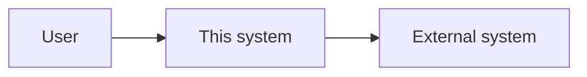

# Architecture

## Style and why
Advisor output (traits: MoneyMovement, RegulatoryAudit, LongRunningWorkflows, SeveralBusinessAreas, ComplexBusinessRules, SmallTeam):

### Recommendation: ModularMonolith

Several business areas need clear boundaries, but one deployment and one database keep it cheap to run and easy to hand over.

#### Patterns
- **AppendOnlyLedger**: Record debits and credits as new entries instead of overwriting a balance, so money always balances and can be traced.
- **IdempotencyKeys**: Every money-moving request carries a key, so a retry can never pay twice.
- **TransactionalOutbox**: Save the change and the event in one transaction, so other parts never miss a payment.
- **AuditTrail**: Keep an immutable record of who did what and when; regulators and clients will ask.
- **Sagas**: Processes that last days or weeks need explicit state and compensating steps, not one long transaction.

#### Closest reference systems
- Lending back office (loans, drawdowns, repayments) (similarity 0.83): Modular monolith (applications, servicing, cash, statements) with an append-only cash ledger and sagas for drawdowns.
- Banking / payments app (similarity 0.57): Modular monolith with an append-only ledger.
- Internet provider (fibre/LTE) (similarity 0.43): Modular monolith, with sagas for weeks-long orders and adapters for the network operators.

#### Risks to watch
- Modules decay into a big ball of mud unless boundaries are enforced by tests (no cross-module database access).
- Floating-point money or update-in-place balances. Use decimal and ledger entries only.

#### Evolve when
- One module needs to scale or deploy on a different schedule: extract only that module as a service.
- Separate teams own separate modules and block each other's releases.

Record the final choice with write_adr, including what you rejected.

Judgement: Build a modular monolith with an append-only cash ledger, idempotency keys, an outbox and sagas for drawdown approval. See `decisions/0001-architecture-style.md`.

## Context

## Modules and boundaries
TODO: each module, what it owns, what it may call.

## Cross-cutting
TODO: auth, logging, tracing, configuration, error handling.