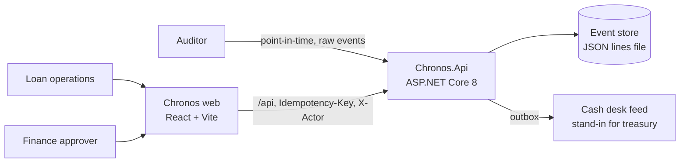

# Architecture

## Style and why
Advisor output (traits: MoneyMovement, RegulatoryAudit, LongRunningWorkflows, SeveralBusinessAreas, ComplexBusinessRules, SmallTeam):

### Recommendation: ModularMonolith

Several business areas need clear boundaries, but one deployment and one database keep it cheap to run and easy to hand over.

#### Patterns
- **AppendOnlyLedger**: Record debits and credits as new entries instead of overwriting a balance, so money always balances and can be traced.
- **IdempotencyKeys**: Every money-moving request carries a key, so a retry can never pay twice.
- **TransactionalOutbox**: Save the change and the event in one transaction, so other parts never miss a payment.
- **AuditTrail**: Keep an immutable record of who did what and when; regulators and clients will ask.
- **Sagas**: Processes that last days or weeks need explicit state and compensating steps, not one long transaction.

#### Closest reference systems
- Lending back office (loans, drawdowns, repayments) (similarity 0.83): Modular monolith (applications, servicing, cash, statements) with an append-only cash ledger and sagas for drawdowns.
- Banking / payments app (similarity 0.57): Modular monolith with an append-only ledger.
- Internet provider (fibre/LTE) (similarity 0.43): Modular monolith, with sagas for weeks-long orders and adapters for the network operators.

#### Risks to watch
- Modules decay into a big ball of mud unless boundaries are enforced by tests (no cross-module database access).
- Floating-point money or update-in-place balances. Use decimal and ledger entries only.

#### Evolve when
- One module needs to scale or deploy on a different schedule: extract only that module as a service.
- Separate teams own separate modules and block each other's releases.

Record the final choice with write_adr, including what you rejected.

Judgement: modular monolith (ADR-0001) with an **event-sourced ledger core and CQRS** (ADR-0002, the advisor's "good alternative" for money + audit). Shared concerns come from vendored Agentic.Blocks packages (ADR-0003).

## Context

## Modules and boundaries
| Project | Owns | May call |
|---|---|---|
| `src/Chronos.EventStore` | `IEventStore`, in-memory + JSON-lines stores, optimistic concurrency, `UpcasterChain` | nothing in Chronos |
| `src/Modules/Ledger/Chronos.Ledger` (write side) | commands, the `Loan` aggregate (internal), Actual/365 day count, event contracts (`Contracts/`), serializer + upcasters | EventStore, Blocks.Core |
| `src/Modules/Statements/Chronos.Statements` (read side) | balance + statement projections (checkpoint, rebuild), point-in-time replay, raw history | EventStore, Ledger **public contracts only** |
| `src/Chronos.Api` | composition root: endpoints, DI, ProblemDetails, health, idempotency, audit, outbox, demo seed | all of the above |

Enforced by `tests/Chronos.Tests/ArchitectureTests.cs`: the store knows no module, the write side never references the read side, no module opens internals to another, the read side uses only public Ledger types.

## Rules that shape the code
- A stream's business dates never go backwards; money cannot move on or before the last accrued day. So point-in-time = replay of a stream prefix.
- A drawdown counts only after a *different* person approves it (four eyes).
- Repayments pay accrued interest first, then principal. Interest: Actual/365 on each day's closing principal, one rounding per accrual (half away from zero).

## Cross-cutting
- Errors: `Result`/`Error` → ProblemDetails (Blocks.Web) with `code`, `traceId`, `correlationId`.
- Idempotency: Blocks.Idempotency on every POST + `commandId` on every event.
- Audit: Blocks.Audit hash-chained log per accepted command (actor ids only); the event stream is the primary audit trail.
- Outbox: Blocks.Outbox `ledger.event-notice.v1` → idempotent `CashDeskNotifier`.
- Time: `TimeProvider` for `recordedAt`; business dates are explicit `DateOnly`s.
- Telemetry: meter `Chronos.Ledger` (`chronos.ledger.concurrency_conflicts`), Blocks meters, correlation ids in logs.
- Auth: demo `X-Actor` header (opaque ids) in slice 1; real login (Blocks.Auth, roles ops/finance/auditor) is slice 2.
