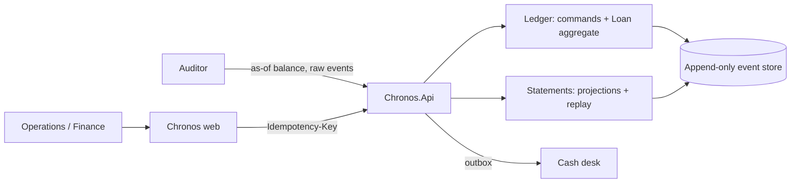

# Chronos

Harbourline Lending (fictional) tracks drawdowns, interest and repayments on property loans in spreadsheets, so cash positions are slow to confirm and hard to audit. Chronos is an event-sourced ledger for property loans: every drawdown request, approval, interest accrual and repayment is an immutable event, and any balance can be replayed to any date.

## Design at a glance
Operations book drawdowns and repayments; finance approves and accrues interest; auditors replay any past position.

**Architecture:** a modular monolith (ADR-0001) whose ledger core is **event-sourced with CQRS** (ADR-0002), the variant the architecture advisor rates a good alternative for money plus audit. A loan is rebuilt from its event stream for every command and appended with optimistic concurrency; balance and statement projections are rebuildable read models; point-in-time answers replay the stream up to the date. Commands are idempotent twice over (Idempotency-Key replay and `commandId` on every event). We pay for it with event versioning (upcasters) and projections. Full reasoning, diagrams and failure modes: [`docs/DESIGN.md`](docs/DESIGN.md).



## What it does (slice 1)
- Open a loan; request a drawdown (pending, **not** in the balance); approve it (a different person must approve).
- Accrue interest **Actual/365** on each day's closing principal; record repayments (interest first, then principal).
- Balance and statement from projections; `GET /api/loans/{id}/balance?asOf=YYYY-MM-DD` replays events up to that date.
- File-backed (JSON lines) or in-memory event store; projections rebuild from position 0.
- React screen: loan list, balance strip, sign-off queue, booking forms, statement that ties to the ledger, "As of" date.

## Run locally
```bash
ASPNETCORE_ENVIRONMENT=Development ASPNETCORE_URLS=http://localhost:5204 dotnet run --project src/Chronos.Api
cd web && npm ci && npm run dev      # http://localhost:5174
dotnet test Chronos.sln && (cd web && npx vitest run)
```
More in `.agentic/runbook.md`. `Agentic.Blocks.*` packages are vendored in `eng/packages/` (ADR-0003).

## How this project is organised
`src/Chronos.EventStore`, `src/Modules/Ledger` (write side), `src/Modules/Statements` (read side), `src/Chronos.Api` (composition root), `tests/Chronos.Tests`, `web/`, `docs/DESIGN.md`.
Project knowledge lives in the hidden `.agentic/` folder (start with `.agentic/README.md`). AI agents read `AGENTS.md` first.

Built with the Baton model from the Agentic Engineering Kit: frame → map → decide → sketch → slice loop → pass the baton.
