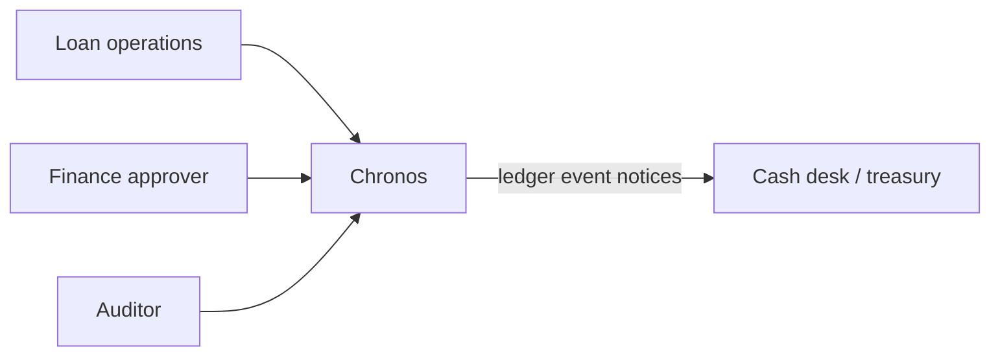
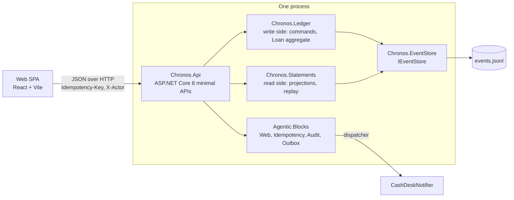
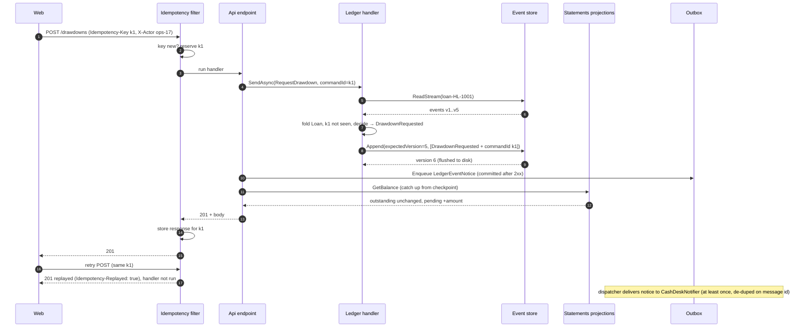
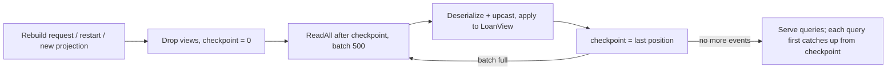
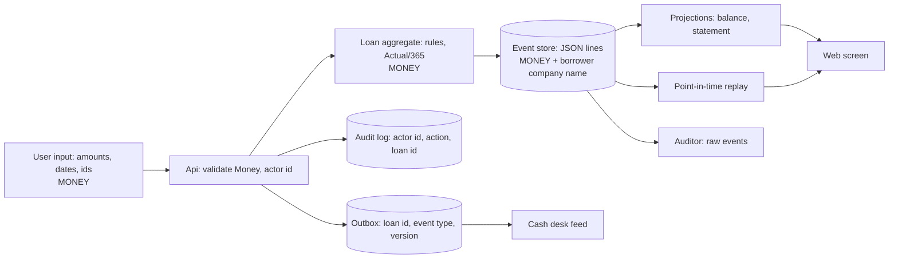
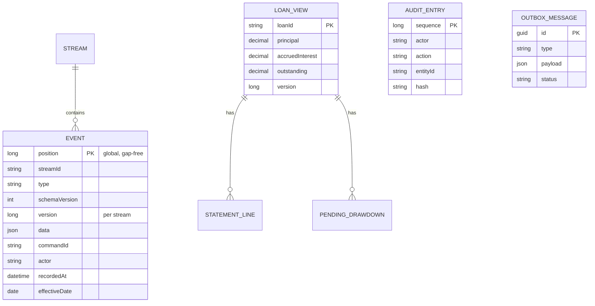

# Chronos: design dossier

> Harbourline Lending is fictional; all names and numbers are invented. Chronos is the code name: balances replay to any date.

## 1. Brief
- **Client:** Harbourline Lending, a property lender.
- **Problem:** drawdowns, interest and repayments live in spreadsheets, so cash positions are slow to confirm and hard to audit.
- **Users:** loan operations (daily), finance (month end), auditors (yearly).
- **Outcomes:** cash position confirmed the same day; interest recalculation matches to the cent.
- **Constraints:** money as decimal; no balance is ever overwritten; every request safe to retry.

## 2. Requirements
**Functional (slice 1, done):** open a loan; request a drawdown (pending, not in balance); approve it (four eyes);
accrue interest Actual/365; record a repayment (interest first); balance and statement; balance as of any date; raw event history.

**Non-functional**
| Need | Target | Where it comes from |
|---|---|---|
| Command latency | p95 < 300 ms | `quality.md` |
| Balance / point-in-time | p95 < 200 ms for streams < 5k events | replay cost, see §3 |
| Read-your-writes | always, in one process | projections catch up before each query |
| Availability | 99.9% / 30 days (business hours matter most) | `quality.md` |
| Duplicates from retries | 0 | Idempotency-Key + `commandId` on events |
| Retention | events forever (7+ years for lending records); projections disposable | assumption, confirm with Harbourline compliance |
| Privacy | no personal data in events beyond borrower company name; actors are opaque ids | §11 |

## 3. Capacity estimate
Assumptions (rounded up): 500 active loans; 30 events per loan per month (drawdown requests/approvals, monthly accrual, repayments); 15 staff users.
- **Writes:** 500 × 30 = 15k events/month ≈ 750/working day ≈ 0.1/s average; month-end peak 50× ≈ 5/s.
- **Reads:** 15 users × 1 refresh/10 s ≈ 1.5 req/s peak; auditor replays are bursty but small.
- **Storage:** ~600 bytes per JSON line → 15k × 600 B ≈ 9 MB/month ≈ 110 MB/year. Ten years fit on any disk.
- **Replay cost:** a 5-year loan ≈ 1.8k events ≈ 1 MB; folding it is ~1 ms. Snapshots are not needed until ~5k+ events per stream.
- **Conclusion:** one small instance is ample; the limits are single-process stores, not load (§9).

## 4. Options considered
`arch-advisor compare MoneyMovement RegulatoryAudit LongRunningWorkflows SeveralBusinessAreas ComplexBusinessRules SmallTeam`:

| Option | Fit | Complexity (1-5) | Main reason |
|---|---|---|---|
| Modular monolith | Recommended | 3 | Matches the advisor's recommended style (ModularMonolith). |
| Modular monolith + CQRS read models | Good alternative | 3 | Same family as the recommendation (ModularMonolith); a valid variant if its trade-offs suit the team. |
| Event-sourced core with CQRS | Good alternative | 4 | Same family as the recommendation (ModularMonolith); a valid variant if its trade-offs suit the team. |
| Static site + serverless function | Poor fit | 1 | The product has real server-side behaviour and data; a static site can't hold it. |
| Layered monolith | Poor fit | 1 | Several business areas would tangle without module boundaries. |
| Vertical slice monolith | Poor fit | 2 | Several business areas would tangle without module boundaries. |
| Clean Architecture monolith | Poor fit | 2 | Several business areas would tangle without module boundaries. |
| Serverless functions + queues | Poor fit | 3 | Consistency-critical money or stock operations are awkward across stateless functions. |
| Microservices (request/response) | Poor fit | 5 | A small team can't run a distributed system well (deployments, tracing, on-call). |
| Event-driven microservices | Poor fit | 5 | A small team can't run a distributed system well (deployments, tracing, on-call). |

- **Modular monolith (recommended by the advisor, ADR-0001):** right shape for a two-person team. Kept as the outer shape.
- **Event-sourced core with CQRS (chosen for the ledger core, ADR-0002):** "complete history and point-in-time replay for
  auditors; new reports from old events". Costs: event versioning and projections (complexity 4 vs 3). Chosen because auditors
  re-perform interest and ask "what was the balance on date D and who approved it?", which an entry table answers only halfway.
- **Modular monolith + CQRS read models:** fast reads, but writes still overwrite state; history would need a second model.
- **Layered / vertical slice / Clean Architecture monolith:** several areas (loans, cash, statements) would tangle without module boundaries.
- **Microservices / event-driven microservices / serverless:** a two-engineer team cannot run a distributed system; money consistency across stateless functions is awkward.
- **Global scale answer:** not a global product (one lender, one region). At 100× (50k loans) it is still one database; partition streams by loan id if ever needed.
- **Evolution trigger (from ADR-0001):** extract a module only if it must scale or deploy on its own schedule, or separate teams block each other.

## 5. Architecture
**C4 context**

**C4 containers**

| Module | Owns | Contract |
|---|---|---|
| Chronos.EventStore | append-only streams, optimistic concurrency, file durability, upcaster chain | `IEventStore.AppendAsync(stream, expectedVersion, events)`, `ReadStreamAsync`, `ReadAllAsync(afterPosition)` |
| Chronos.Ledger | commands, `Loan` aggregate (internal), Actual/365, event contracts | `ILedgerCommands.SendAsync(command, context)` → `Result<CommandOutcome>`; events in `Contracts/` |
| Chronos.Statements | balance + statement projections, point-in-time, history | `ILoanQueries` |
| Chronos.Api | HTTP, DI, ProblemDetails, health, audit + outbox per command, demo seed | REST under `/api` |

Endpoints: `GET /api/loans`, `GET /api/loans/{id}`, `GET /api/loans/{id}/balance?asOf=`, `GET /api/loans/{id}/statement?from=&to=`,
`GET /api/loans/{id}/pending`, `GET /api/loans/{id}/events`, `POST /api/loans`, `POST /api/loans/{id}/drawdowns`,
`POST /api/loans/{id}/drawdowns/{drawdownId}/approve`, `POST /api/loans/{id}/interest-accruals`, `POST /api/loans/{id}/repayments`,
`POST /api/projections/rebuild` (Development), `GET /api/cash-desk/feed`, `/health/live`, `/health/ready`.

## 6. Communication flows
**Event flow: request and approve a drawdown (sync command, async notice)**

**Riskiest flow: two writers race on one loan**
```mermaid
sequenceDiagram
  participant A1 as Command A (repayment)
  participant A2 as Command B (drawdown request)
  participant S as Event store
  A1->>S: ReadStream → v5
  A2->>S: ReadStream → v5
  A2->>S: Append(expected 5) → v6 ✓
  A1->>S: Append(expected 5)
  S-->>A1: WrongExpectedVersion (actual 6)
  A1->>A1: jittered back-off (1..4n ms)
  A1->>S: ReadStream → v6, decide again on fresh state
  A1->>S: Append(expected 6) → v7 ✓
  Note over A1: after 10 failed tries → 409 ledger.concurrency_conflict; client retries with the same key
```
**Projection rebuild flow**

Point-in-time does not use the projection: it reads `loan-{id}` and folds events while `effectiveDate <= asOf` (a prefix, because business dates in a stream never go backwards).

## 7. Data flow

Personal data: none by design. Borrowers are companies; actors are opaque ids (`ops-17`), never names.

## 8. Data model

| Entity | Owner | Consistency |
|---|---|---|
| EVENT (stream) | EventStore / Ledger | strong per stream (expected version); append-only |
| LOAN_VIEW, STATEMENT_LINE, PENDING_DRAWDOWN | Statements | derived; read-your-writes in-process, rebuildable |
| AUDIT_ENTRY | Blocks.Audit | append-only, hash-chained; written after the event (best effort; events remain the primary trail) |
| OUTBOX_MESSAGE | Blocks.Outbox | committed after a 2xx; delivered at least once |

**Event versioning strategy**
- Each event has a stable type name and a `schemaVersion`. Contracts live in `Chronos.Ledger/Contracts` and are treated as public.
- Additive change → new version + an upcaster step registered in `LedgerEventSerializer` (e.g. `InterestAccrued` v1→v2 adds `dayCount = "Actual/365"`). Stored events are never rewritten.
- Meaning change → a new event type; old events keep their old meaning.
- Every upcaster has a test that reads a stored old-version payload (`EventStoreTests.An_old_schema_version_is_upcast_on_read`).
- Derived fields (`effectiveDate`) are not stored in the payload; the metadata copy drives replay.

## 9. Scaling path
1. **Single-process stores** break first (file store, in-memory idempotency/outbox): move to one Postgres/SQL Server with `events(stream_id, version)` unique, idempotency and outbox tables in the same database, outbox written in the same transaction as the events.
2. **Projection catch-up on the request path:** move to a background subscriber with a persisted checkpoint; reads become eventually consistent (return the projection version so the UI can wait for its write).
3. **Long streams:** snapshots every N events (state + version), replay from the snapshot.
4. **Read load / reporting:** extra projections in a reporting store; old events build new reports.
5. **Extract a module** only on the ADR-0001 trigger.

## 10. Failure modes
| Failure | Effect | Mitigation |
|---|---|---|
| Duplicate request (client retry) | could double-book | Idempotency filter replays; `commandId` on events makes the handler a no-op even after cache expiry |
| Concurrent commands on one loan | lost update | expected-version append; reload-and-retry with jitter; 409 after 10 tries |
| Crash mid-append | torn last line | file flushed before events are visible; torn final line cut on open; gap check on load |
| Outbox handler fails | cash desk not told | retry with back-off, dead letter after max attempts; handler idempotent on message id |
| Projection bug | wrong numbers on screen | events untouched; fix code and rebuild from position 0; property test guards |
| Bad/old event schema | read fails | upcaster chain; unknown type fails loudly at read |
| Hot loan (many writers) | conflicts climb | metric `chronos.ledger.concurrency_conflicts`; queue commands per loan if sustained |
| Disk full / store down | writes fail | `/health/ready` reads the store; 5xx means nothing was stored, retry is safe |
| Region outage | no service | single region; restore event file/database from backup (events are the whole state) |

## 11. Security and privacy
- **AuthN/AuthZ:** slice 1 uses a demo `X-Actor` header (opaque ids, validated pattern). Slice 2 moves to Blocks.Auth with roles ops / finance / auditor; approval requires finance and a different user (four eyes is already a domain rule).
- **Data protection (POPIA/GDPR):** no personal data in events; borrowers are companies; actor ids only. Corrections are compensating events; if erasure were ever needed, keep personal data out of events (or crypto-shred a per-subject key).
- **Integrity:** events append-only; audit log hash-chained (`VerifyIntegrityAsync`). The production database user gets INSERT/SELECT only on events.
- **Secrets:** none in the repo; `.env` ignored; gitleaks + privacy guard in CI.
- **Threats per flow:** replay of a POST → idempotency; self-approval → four-eyes rule; backdating into a closed period → `ledger.period_closed`; event file tampering → gap check (+ database permissions in production); rebuild endpoint → Development only.

## 12. Observability
- **SLIs/SLOs:** see `.agentic/quality.md` (command success 99.9%, p95 < 300 ms, projection = replay 100%, zero duplicate money movements).
- **Metrics:** `chronos.ledger.concurrency_conflicts`, Blocks Outbox `agentic.blocks.outbox.*` (enqueued, dispatched, failed, dead_lettered), ASP.NET request duration.
- **Traces/logs:** `X-Correlation-Id` echoed and in every ProblemDetails; logs carry ids, not names.
- **The alert that wakes someone:** outbox dead letters > 0 or command 5xx rate burning the error budget 10× during business hours.

## 13. Testing strategy
| Layer | What | File |
|---|---|---|
| Rules | Actual/365 (leap years, rounding), aggregate rules (pending, four eyes, limit, currency, interest-first, closed period, monotonic dates) | `DayCountTests.cs`, `LoanAggregateTests.cs` |
| Property | 150 random command sequences (fixed seed 20261120): projection = independent day-by-day oracle = point-in-time replay = rebuilt projection; retries never add events | `ProjectionPropertyTests.cs` |
| Seams | both stores: append/read, versions, conflicts, restart, torn line; upcasting | `EventStoreTests.cs` |
| Concurrency | injected race retried (2 attempts), 25 parallel commands, exhausted retries → 409 | `PointInTimeAndConcurrencyTests.cs` |
| Journeys (HTTP) | real Kestrel host via `KestrelTestHost` | `ApiAcceptanceTests.cs` |
| Boundaries | module references and internals | `ArchitectureTests.cs` |
| Web | money formatting, sum of effects, view states, idempotent retry client | `web/src/*.test.ts` |

| Acceptance criterion (backlog slice 1) | Test |
|---|---|
| Posted twice with one idempotency key → one entry | `ApiAcceptanceTests.Posting_the_same_drawdown_twice_with_one_idempotency_key_creates_one_event` (+ property test retries) |
| Balance is always the sum of entries | `ApiAcceptanceTests.The_balance_is_always_the_sum_of_the_ledger_events`, `ProjectionPropertyTests` |
| Awaiting sign-off → not in balance until approved | `ApiAcceptanceTests.A_drawdown_awaiting_sign_off_is_not_in_the_balance_until_approved`, `LoanAggregateTests` |

## 14. Interview questions
1. **Why event sourcing when the advisor recommended a modular monolith?** It is the same monolith; only the ledger core is event-sourced, because auditors need full history and point-in-time replay. The advisor rates it a good alternative for exactly this; ADR-0002 records the costs.
2. **What if the same drawdown is posted twice?** The Idempotency-Key filter replays the stored 201 without running the handler. If the cache has expired, the key is on the event as `commandId`, so the handler returns "duplicate" and appends nothing.
3. **Two people book on the same loan at once?** Both read version 5; the first append wins; the second gets a version conflict, reloads, re-decides on fresh state and appends version 7. After 10 losses it returns 409 and the client retries with the same key.
4. **How do you answer "balance on 31 March"?** Replay the loan's events dated on or before 31 March. Dates in a stream never go backwards, so that is a prefix of the stream; no projection is involved.
5. **How do you change an event's shape?** New schema version plus an upcaster that converts old payloads on read; stored events are never rewritten; a test reads an old payload.
6. **A projection had a bug. Now what?** Fix the code, rebuild from position 0. Events are the truth; projections are disposable.
7. **Why Actual/365 and how is rounding done?** It is the contract convention: actual days over 365, also in leap years (2028 gives 7,320.00 on 100k at 7.3%, not 7,300.00). Interest is summed over the period on each day's closing principal and rounded once per accrual, half away from zero.
8. **How would you scale to 100× loans?** Still one database: events table with a unique (stream, version), outbox in the same transaction, background projection subscriber with a checkpoint, snapshots for long streams.
9. **How do you correct a mistake in a closed period?** You cannot edit history. Book a compensating event (for example an interest adjustment) dated in the open period; the statement shows both.
10. **Where can money get lost?** Not in the ledger: events are flushed before the 2xx. Notices to the cash desk are at least once with idempotent handlers; dead letters raise an alert.
